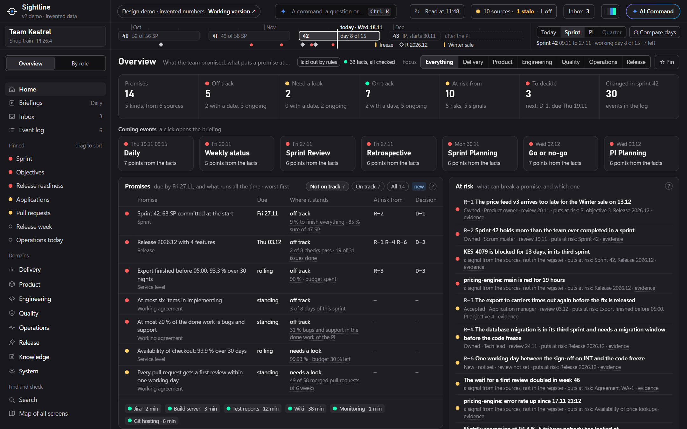
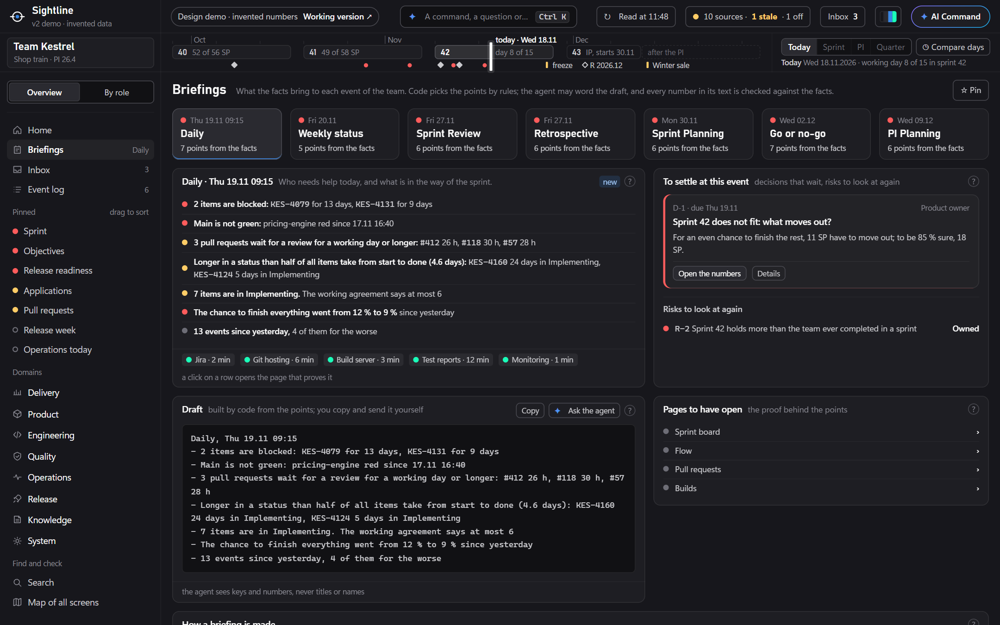
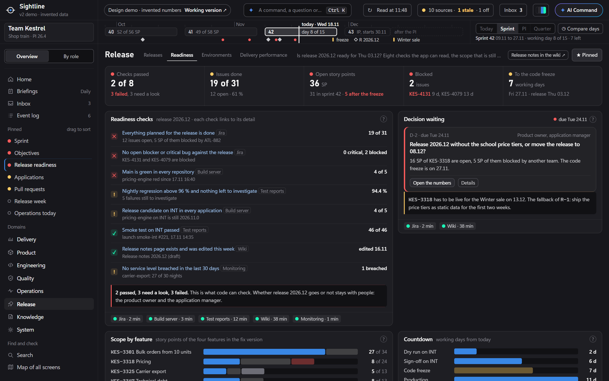
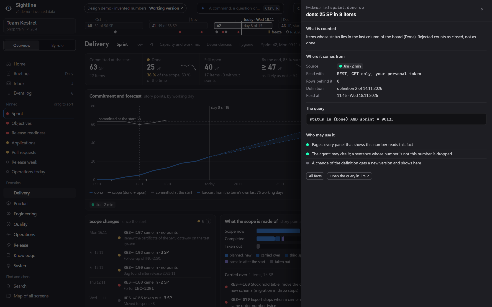
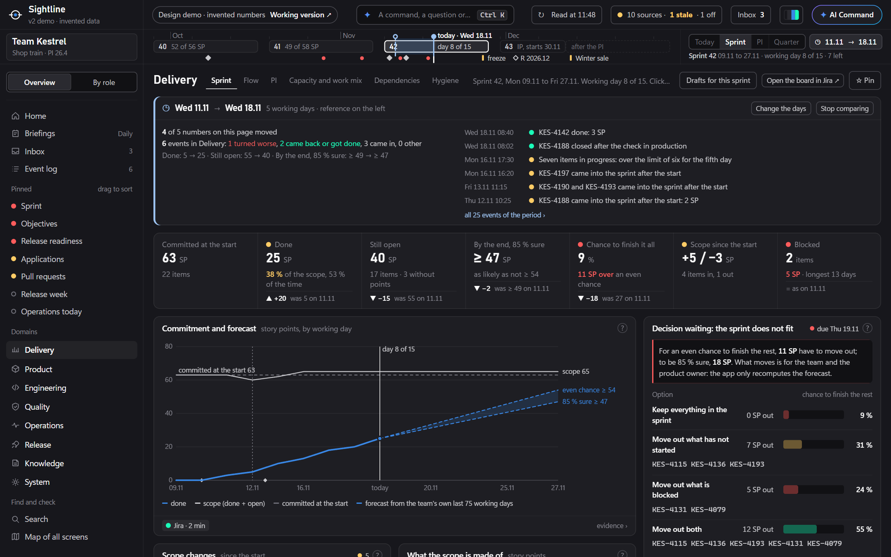
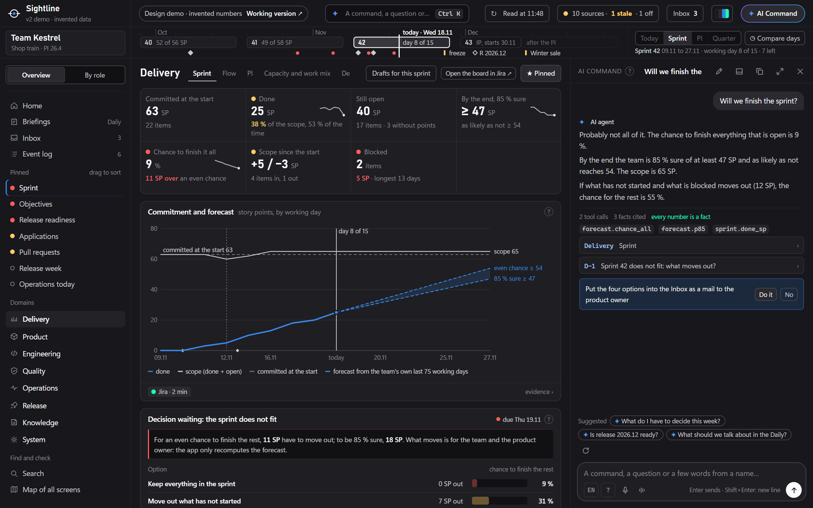
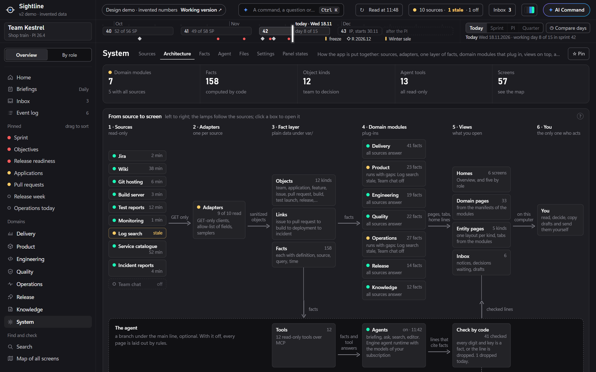
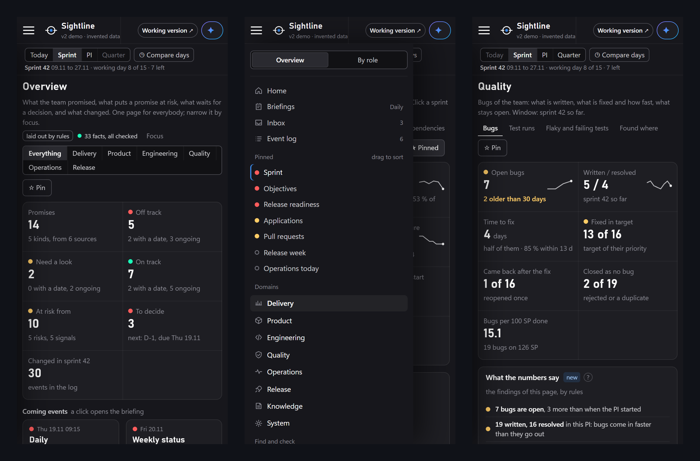

<div align="center">

# Sightline

**A delivery cockpit for agile teams.**

[](https://github.com/bolevin/sightline/actions/workflows/ci.yml)


<a href="https://bolevin.github.io/sightline/"></a>

It runs in your browser, on a phone too. Nothing to install.

<a href="https://bolevin.github.io/sightline/"></a>

</div>

Every week the same questions come to a Scrum Master, a product owner and a team lead. Will we keep what we
promised? What puts it at risk? What waits for a decision? What changed since yesterday? The answers sit in Jira,
in the build server, in monitoring and in people's heads. I built Sightline to put them on one screen, with the
evidence behind every number.

This is version 2. The live demo shows its design: 52 pages for Kestrel, an invented team that runs the checkout
of an online shop. The team and every number in the demo are invented and prepared by hand. Nothing in it is
computed yet. The working core it will run on is described under [What runs today](#what-runs-today).

## The home screen

The Overview answers four questions: what the team promised, what puts a promise at risk, what waits for a
decision and what changed. A promise can be a sprint, a release date, a service level or a working agreement. The
Focus switch narrows the page to one area, for example operations. The time control on the top right switches
between today, the sprint, the PI and the quarter.

## Briefings for the events of the team



There is a briefing for the Daily, the weekly status, the Sprint Review, the retrospective, the Sprint Planning,
the go or no-go of a release and the PI Planning. It lists the points the facts bring to that event and the
decisions that wait. Below them is a draft to copy. You send it yourself: Sightline writes to no other system.

## Seven domains behind it



Delivery, Product, Engineering, Quality, Operations, Release and Knowledge. Each domain has its own pages: the
sprint and the PI, objectives and features, pull requests and builds, bugs and test runs, applications and
incidents, release readiness, risks and decisions. An issue, a feature, an application, an incident and a release
each have a page of their own.

The home screen shows the conclusions. The domains show the proof.

## Every number opens its evidence



Click a number and you see what is counted, where it comes from, the query, the rows behind it and when it was
read. When a source is late or down, every panel that uses it says so. It doesn't show an old number as if it
were new.

## What changed between two days



Pick two days, and every page shows what happened in between and how each number moved. The event log behind it
lists every change the reads found: an item that turned worse, one that came back, work that came into the sprint.

## Ask it



AI Command answers a short command at once from the facts. A question goes to an agent that cites the facts it
used, and a line with a number that is not in those facts is dropped. When the agent proposes something, the
proposal only touches your own notes. In the demo the answers are prepared.

## How it is put together



The sources are only read. Adapters turn each read into plain records, one layer of facts holds every number with
its definition, and each domain is a module that plugs into that layer. The agent is a branch you can switch off:
then the pages are laid out by fixed rules from the same facts. Thresholds and release checks are plain files that
you can read and change.

## On a phone



## What runs today

The first version is working code, and it is in this repository. It reads one team's sprint from Jira data,
computes every number in code and forecasts the sprint from the team's own history. It shows an AI line only after
code has checked it against the facts. It also shows pull requests, builds and deploys, bugs and incident reports.
Version 2 is to be built on this core. Its demo is the [working version](https://bolevin.github.io/sightline/demo/),
on the same invented team.


To run it yourself:

```
git clone https://github.com/bolevin/sightline
cd sightline
python run.py --open
```

Python 3.10 or newer, no packages to install. The page opens at `http://127.0.0.1:8780`.

```
python -m unittest discover -s tests
```

runs the 128 tests. The description of this core follows the arc42 template:
[docs/architecture.md](docs/architecture.md). The decisions and what each one costs are in [docs/adr](docs/adr).

## What it never does

It doesn't write to Jira or to any other system. It doesn't count, rank or name people. Nothing in this repository
comes from a real project: the team, its issues and every number are invented.

## What I did

I'm a Scrum Master and release manager, and this started from my own problem: I wanted to walk into a planning or
a steering meeting with numbers I could defend. I took Sightline from the first idea to a working product. Then I
redesigned it as version 2. I looked at how other tools answer these questions, decided what a team needs on one
screen and what it must never do, and laid out the architecture the next build follows. The code was written by
AI coding agents that I direct the way a tech lead directs a team: I review, accept or send back every change.

<div align="center">

<a href="https://bolevin.github.io/sightline/"></a>

See it for yourself. The demo runs in your browser, on invented data.

</div>

## License

[GPL-3.0-or-later](LICENSE).
