<div align="center">

# Sightline

**The delivery cockpit for Scrum Masters who are expected to know, not to guess.**

[](https://github.com/bolevin/sightline/actions/workflows/ci.yml)


<a href="https://bolevin.github.io/sightline/"></a>

It runs in your browser, on a phone too, on invented data. Nothing to install.

<a href="https://bolevin.github.io/sightline/">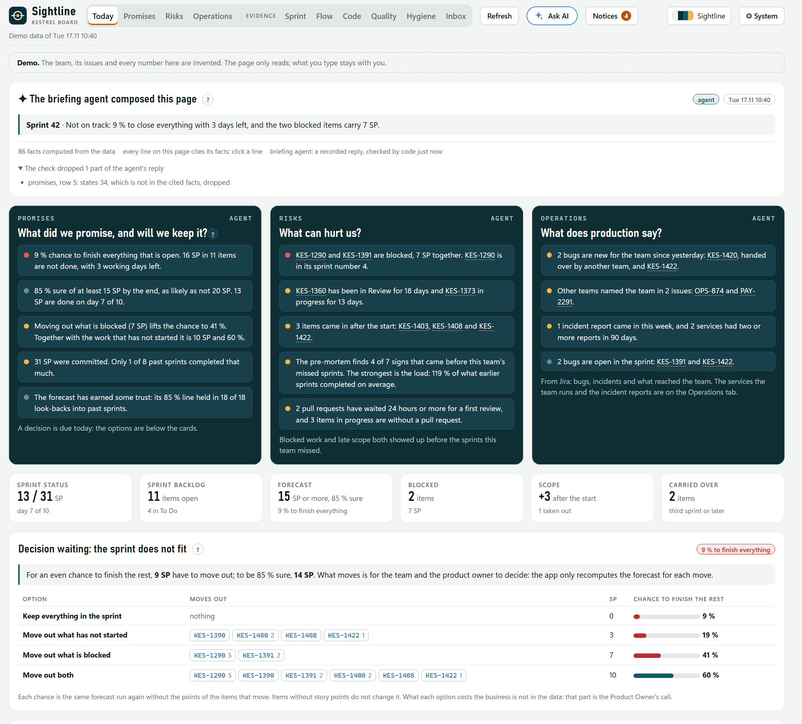</a>

</div>

A Scrum Master who only runs the ceremonies reports what already happened. The one a business trusts can say on
Tuesday whether Friday's promise will hold, what stands in its way and what to do about it. I built Sightline to
be that second kind.

It reads one team's sprint from Jira and answers three questions on one page:

- What did we promise, and will we keep it?
- What can hurt us?
- What does production say?

Every line on the page opens the facts behind it. No number on it was written by a language model.

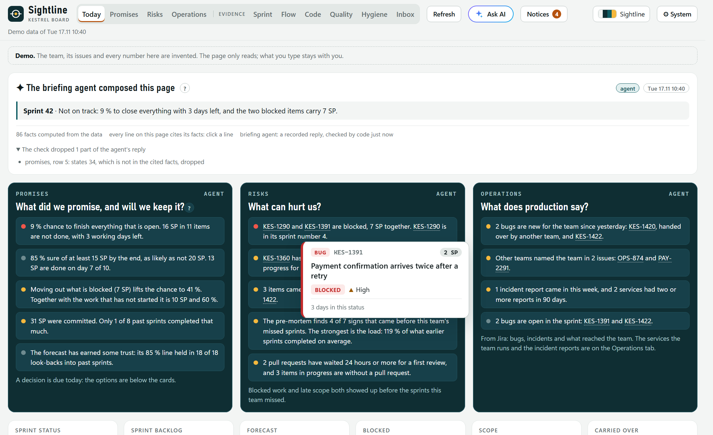

Rest the pointer on any issue key and you get its card: title, type, priority, status and how long it has been
there. You never have to remember what KES-1391 was.

## The same meeting, with and without it

| Someone asks | The usual answer | The answer with Sightline |
|---|---|---|
| Will we make the sprint? | "We're a bit behind, but the team is confident." | "As it stands, 9 %. If the two blocked items move to the next sprint, 41 %. With the work nobody has started, 60 %." |
| Why do we keep missing? | "Too much unplanned work, I think." | "All three sprints we missed had blocked work at this point. None of the five we kept did." |
| How sure are you? | "It's an estimate." | "The 85 % line held in 18 of 18 look-backs. Here is each one." |
| Is production OK? | "No big incidents that I know of." | "Two services had two or more incident reports in 90 days, and two bugs arrived since yesterday." |
| What do you need from me? | "Let's talk after the Daily." | A note with the options and what each one buys, ready to send. |

The numbers in the right column are the ones the demo shows for its invented team.

## What you get

### A forecast instead of a feeling

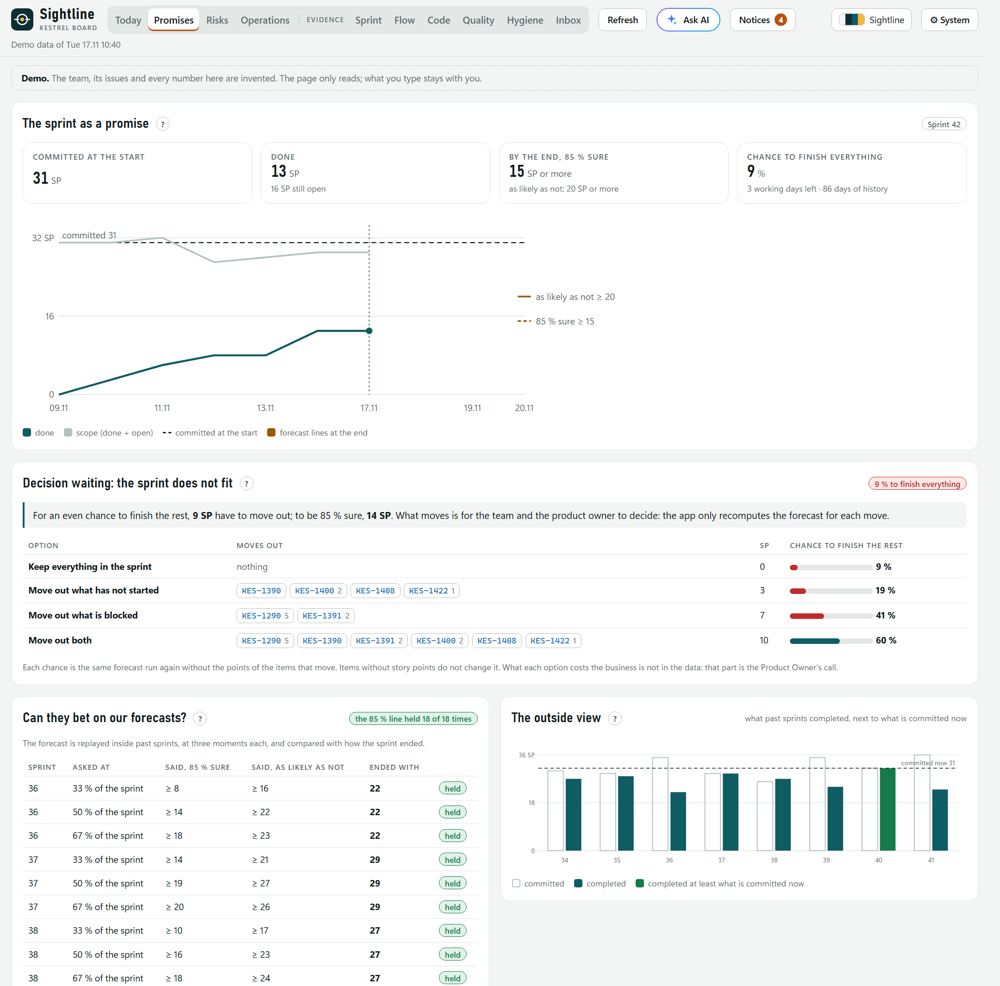

The forecast comes from the team's own history, day by day, not from a line drawn with a ruler. It is a range
with a probability: "85 % sure of at least 15 story points". When the sprint doesn't fit, Sightline runs the
forecast again for each way out, so you walk into the conversation with options and what each one buys.

It also keeps score. Every forecast it showed is compared later with how the sprint ended, and the page says how
often the forecast held. A forecast you can't check is an opinion.

### Risks before they become a status report

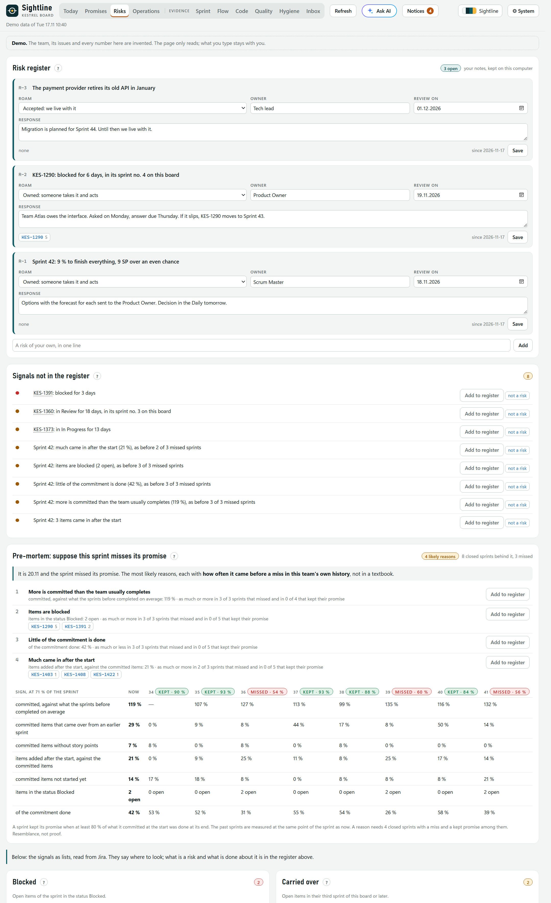

Sightline looks for what usually hurts a sprint: work that is blocked, stuck in one status, carried over for the
third time, or added after the start. Then it does a pre-mortem with the team's own past. It measures the running
sprint against the sprints this team missed and the ones it kept, at the same point in time, and tells you which
signs the missed ones had in common.

What is a risk and what is not stays your call. The register holds your decision: who owns it, what is done about
it, when you look again. Sightline watches the signal behind each entry and tells you when it is gone.

### Production on the same page

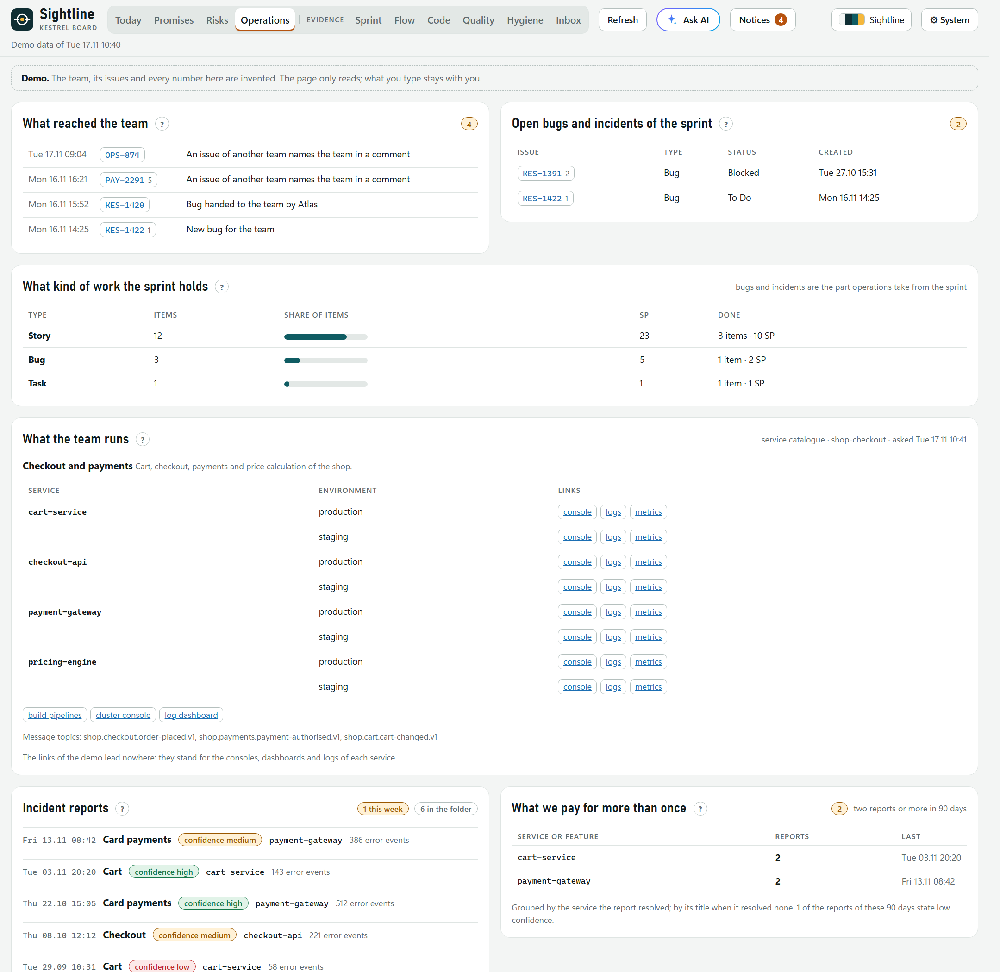

New bugs, work handed over by other teams, incident reports and the services that show up in them more than once.
A team that is asked about delivery and not about production only sees half of its own work.

### Evidence for every claim

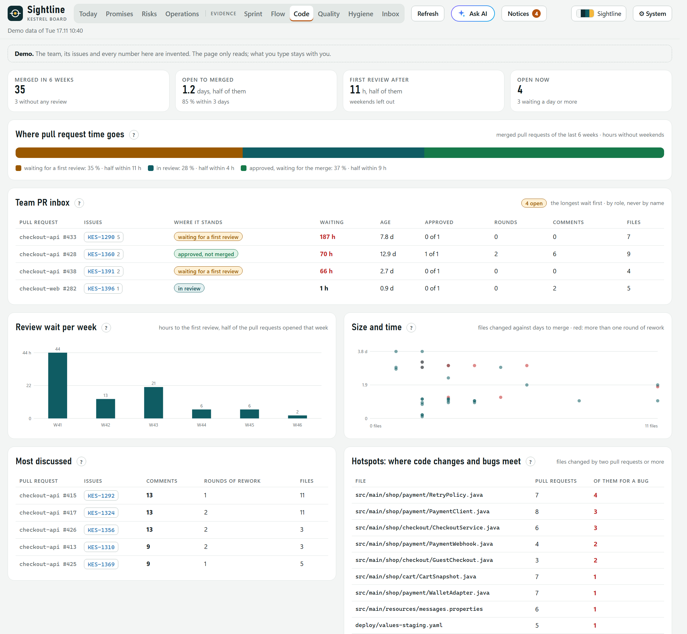

The scope of the sprint as Jira's own sprint report counts it. Flow and cycle times. Where pull requests wait for
a review and how long. The files where code changes and bugs keep meeting. This is where a Scrum Master starts
talking about engineering practice with numbers instead of impressions.

### How the team ships

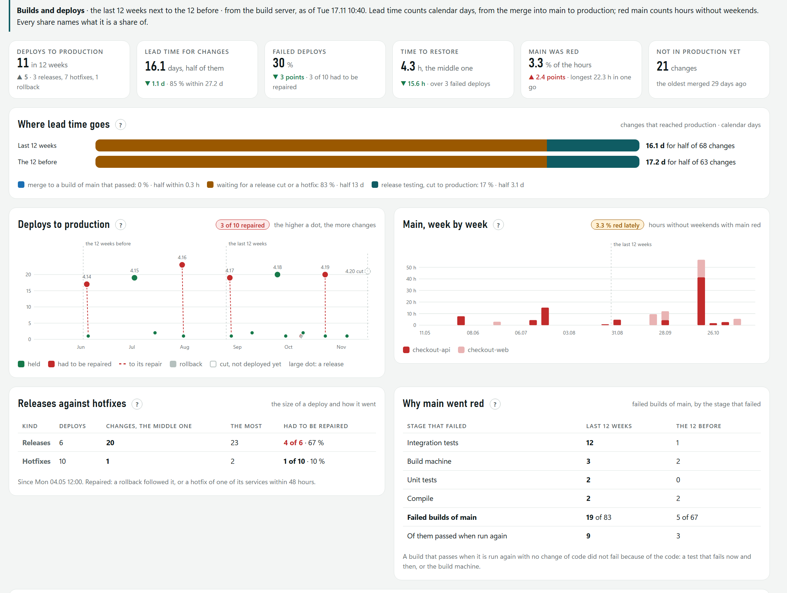

Under the pull requests the Code tab reads the build server: every build of main and every deploy to production.
From these it computes the four DORA measures. How often the team deploys, how long a change takes from the merge
to production, how many deploys had to be repaired, and how long the repair took. Each one stands next to the
twelve weeks before.

In the demo data the picture is clear. Half of the changes need 16.1 days to reach production, and 83 % of that
time they wait for the next release cut. 4 of 6 releases had to be repaired within two days. Of 10 hotfixes with
one or two changes each, 1 had to be. I would take that into a retrospective about smaller releases. The page also
shows how often main was red and why: 9 of 19 failed builds passed when they ran again, so the tests that fail now
and then are the first thing to look at.

### What the bugs are telling you

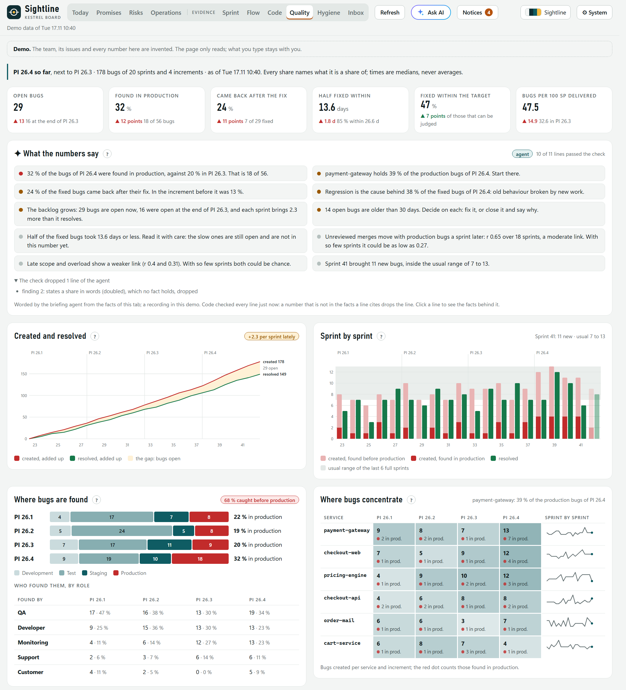

A count of open bugs says almost nothing. The Quality tab reads every bug of the last four increments and asks
what a team lead would ask. Are bugs coming in faster than they go out? How many are found in production, and is
that share growing? Which service do they sit in, and what caused them? How many came back after the fix?

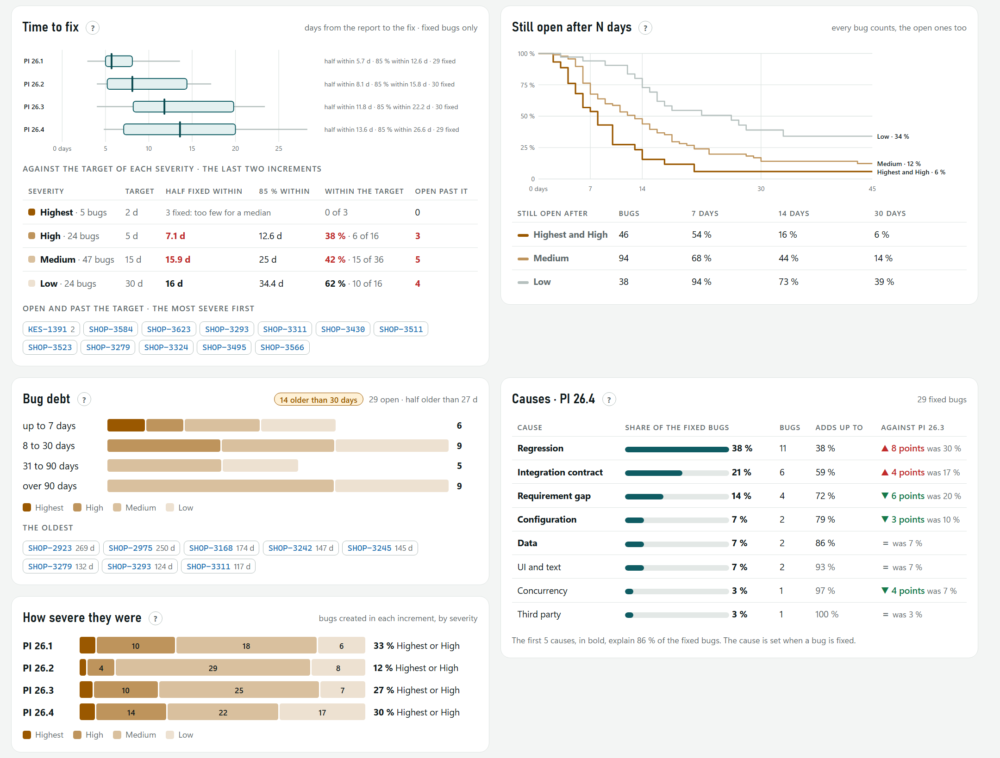

I wanted it careful with statistics, because one wrong number here costs the trust in all the others. Times are
medians, not averages. Every share says what it is a share of. A bug that is still open and past its target
counts as missed, so leaving the hard ones open can't make the numbers look better. Below five bugs you get the
count and no median. And next to "time to fix", which only knows the bugs that were fixed, there is a curve of
the bugs still open after N days, which knows all of them.

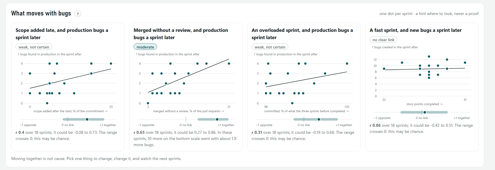

The tab also looks for what moves together with bugs: scope added late, merges without a review, an overloaded
sprint. For each one it shows how strong the link is and how wide the range is with only twenty sprints. When the
range crosses zero, the page says it may be chance. It tells you where to look. It doesn't prove anything.

At the top an agent writes what stands out, in plain sentences, and each sentence goes through the same check as
every other line. In the demo one of them says the share of production bugs "doubled". It went from 20 % to
32 %, so the check drops it.

The tab leaves one thing out on purpose. It doesn't count bugs per person.

### The texts you would write anyway

Sprint status, a note to the Product Owner when the sprint doesn't fit, points for the Daily, a sprint review and
questions for the retrospective. They are composed from the same facts as the page, so the numbers match. You
edit, copy and send. Sightline sends nothing.

## AI you can check

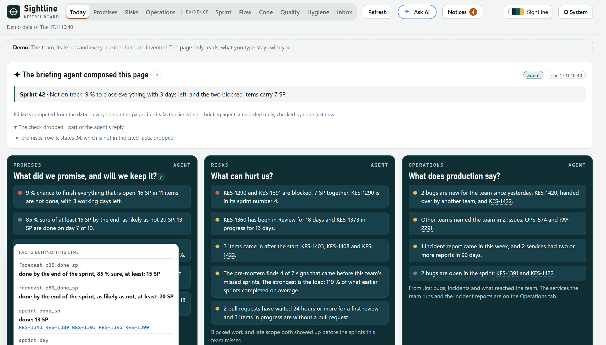

Most AI assistants for agile teams ask you to trust a summary. I didn't want to defend a number in front of a
steering committee that a model made up. So Sightline is built the other way round.

Code computes every number, from the issues and their history. A model only gets these facts. It picks what
matters this morning and puts it into words, and each line has to name the facts it rests on. Then code checks
every line. A number that is not in the named facts, an issue key that does not belong, a share the model worked
out by itself: the line is dropped and the page says why.

You can watch this happen in the demo. The recorded reply of the briefing agent has one wrong line in it on
purpose, and the check catches it.

The same facts are offered to any agent of your own as four read-only tools over the Model Context Protocol. An
agent gets no files, no shell and no way to change an issue.

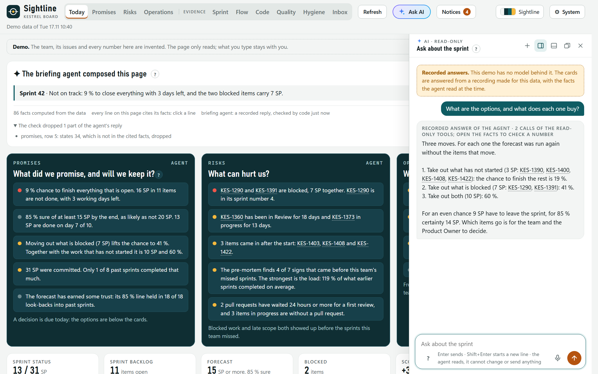

The Ask window answers questions about the sprint from the same facts. You can type a question or say it: the
microphone uses the speech recognition of your browser. In the demo its answers are recordings.
The page also comes in a dark palette, [like this](docs/img/dusk.png).

And three things Sightline never does. It doesn't write to Jira or to any other system. It doesn't count, rank or
name people. It doesn't give an issue title to a model: a title is shown to you on the card of the issue and goes
nowhere else, and descriptions and comments are not read at all.

## Try it

The [live demo](https://bolevin.github.io/sightline/) needs nothing. To run it yourself:

```
git clone https://github.com/bolevin/sightline
cd sightline
python run.py --open
```

Python 3.10 or newer, no packages to install. The page opens at `http://127.0.0.1:8780`.

```
python -m unittest discover -s tests
```

runs the 120 tests. To let an agent of your own read the sprint, point an MCP client at
`http://127.0.0.1:8780/mcp` while the page runs.

## How it is built

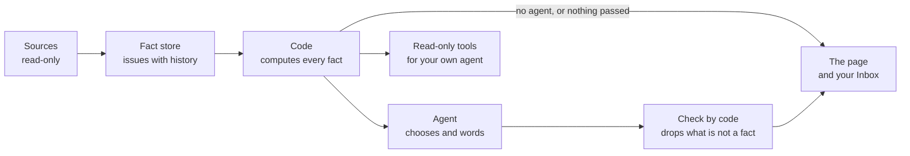

Four decisions carry the design.

- A model never computes. It only chooses among facts, and its text is checked against them.
- Nothing is sampled or stored to look back. Jira's changelog is enough to rebuild any sprint as it stood on any
  day, so there is no database.
- The application can only read. Your notes are the one thing it writes, into two files next to it.
- Python standard library only. It starts on a locked-down laptop without an install.

The full description follows the arc42 template: [docs/architecture.md](docs/architecture.md). The decisions and
what each one costs are in [docs/adr](docs/adr).

The demo draws its own architecture on the System tab: who talks to whom, what goes over each link, what leaves
the computer, and which parts run in the demo. The numbers on the map are those of the page at that moment.

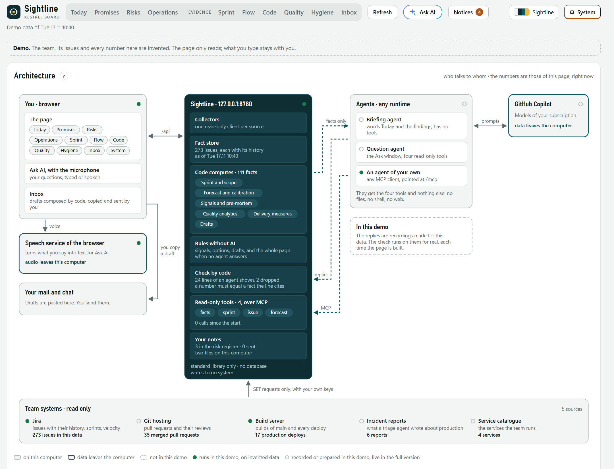

## What is in this demo, and what is not

| | In this demo | In the full version |
|---|---|---|
| Sprint data | A folder of invented data in Jira's own format, with the generator that wrote it | Jira itself, read while the page is open |
| Facts, forecast, pre-mortem, risk register, drafts | The real code | The same |
| Check of the agent's reply | The real code, on a recorded reply | The same, on live replies |
| Agents | Recordings | Agents on a language model |
| Read-only tools for agents | Real, at `/mcp` | The same |
| Issue titles on the cards | Invented, in the data folder | Read from Jira when a card opens, shown and not kept |
| Bugs of the Quality tab | Invented, 178 bugs over 20 sprints, with their own generator | Read from Jira |
| Builds and deploys | Invented, 169 builds of main and 17 deploys over half a year, with their own generator | A read-only client for the build server, still to come |
| Pull requests, incident reports, services | Prepared views of invented inputs | Read from the systems |
| Search in plain language, more sources | Not included | Included |

The team "Kestrel", its issues and every number in the demo are invented. Nothing in this repository comes from a
real project.

## What I did

I'm a Scrum Master and release manager, and this started from my own problem: I wanted to walk into a planning or
a steering meeting with numbers I could defend. I took Sightline from the first idea to a working product. I
decided what it answers and what it must never do, designed the architecture, wrote the rules the code has to
keep and chose what gets tested. The code itself was written by AI coding agents that I direct the way a tech
lead directs a team: I review, accept or send back every change.

<div align="center">

<a href="https://bolevin.github.io/sightline/"></a>

See it for yourself. The demo runs in your browser, on invented data.

</div>

## License

[GPL-3.0-or-later](LICENSE).
