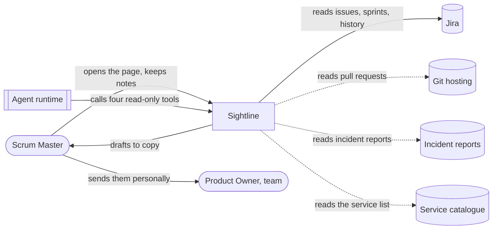
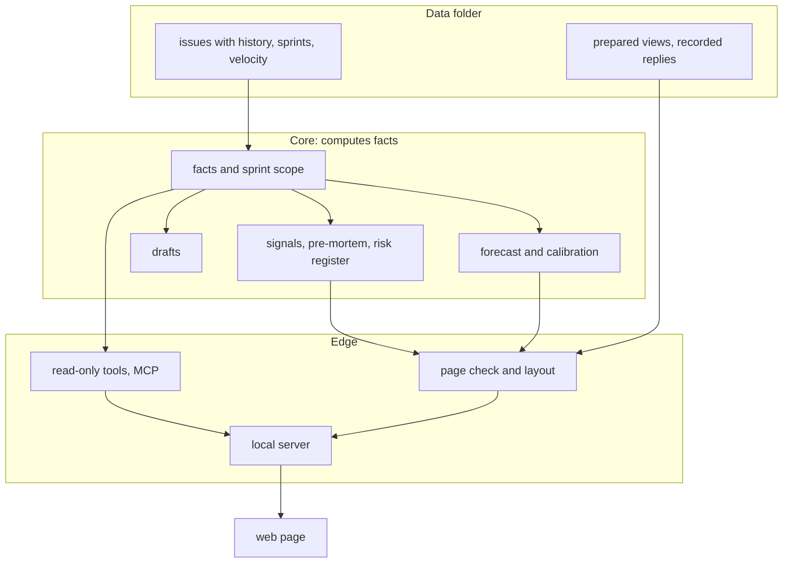
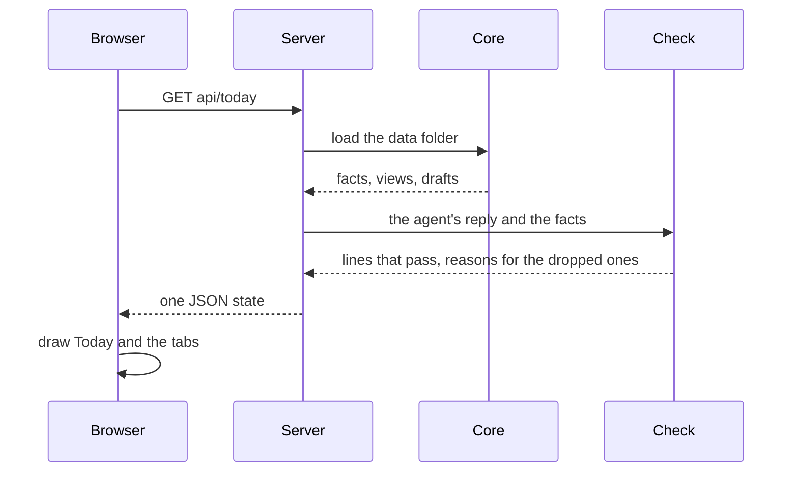

# Sightline architecture

This document follows the [arc42](https://arc42.org) template. It describes the demo in this repository and says
where the full version differs. It is short on purpose: each section holds what you need to judge the design, and
no more.

## 1. Introduction and goals

Sightline is a local web application for a Scrum Master who is expected to lead delivery, not only to run the
ceremonies. It answers three questions about one team's sprint, every time the page is opened:

1. What did we promise, and will we keep it?
2. What can hurt us?
3. What does production say?

Behind the answers are tabs with the evidence, a risk register, and drafts of the texts a Scrum Master sends.

**Quality goals, in order**

| Goal | What it means here |
|---|---|
| Trust in every number | A number on the page is computed by code from the source data and can be traced to the issues behind it. A language model never produces a number. |
| Safe to point at real systems | The application reads. It cannot change an issue, post a message or send a mail. |
| Privacy | No names of people, no descriptions, no comments. A title is shown to the person at the page and given to nobody else. Team level only. |
| Runs anywhere | One process, Python standard library only, no database, no build step. |
| Honest about uncertainty | A forecast is a range with a probability, and the application keeps score of its own forecasts. |

**Stakeholders**

| Who | What they need from it |
|---|---|
| Scrum Master | The state of the sprint in a minute, with arguments for the next conversation. |
| Product Owner | Early notice when the sprint does not fit, with options and what each option buys. |
| Team | No ranking, no surveillance. Signals about work items, never about people. |
| Security and data protection | Read-only access, nothing personal stored, no title or text given to a model. |

## 2. Constraints

- Python 3.10 or newer, standard library only. The page is plain HTML, CSS and JavaScript without a framework.
- The server listens on 127.0.0.1 and nowhere else.
- Sources are read-only. The only files the application writes are the user's own notes.
- The demo has no access to any real system: its data folder is invented, and so is everything derived from it.

## 3. Context and scope

Solid lines run in the demo, on invented data in Jira's own format. Dashed lines are prepared views in the demo
and live reads in the full version. Sightline never writes to any of the systems on the right, and it sends
nothing: the Scrum Master copies a draft and sends it.

## 4. Solution strategy

| Decision | Why |
|---|---|
| No number comes from a model | A model is good at choosing what matters and saying it well, and bad at arithmetic. So it gets facts, not raw data, and every line it writes is checked against the facts it cites. [ADR 0001](adr/0001-no-number-comes-from-a-model.md) |
| History instead of a database | Jira keeps the current value of each field and a changelog. From these two, any fact about a sprint can be computed for any past moment. Nothing has to be stored to look back. [ADR 0002](adr/0002-history-instead-of-a-database.md) |
| Read-only and local | The cheapest way to be safe is to have no way to cause harm. [ADR 0003](adr/0003-read-only-and-local.md) |
| No people, and a title is for the eyes only | What the numbers need is keys, types, statuses, points and dates. A title is shown on the card of an issue and travels on a path of its own, so it cannot end up in a fact or in front of a model. [ADR 0004](adr/0004-no-people-titles-for-the-eyes-only.md) |
| Standard library only | A tool for one person on a company laptop must start without an install and without a review of forty packages. [ADR 0005](adr/0005-standard-library-only.md) |
| The demo replaces the outside world with files | The same code path runs in the demo and in the full version, up to the point where data enters. [ADR 0006](adr/0006-the-demo-replaces-the-outside-with-files.md) |

## 5. Building block view

| Block | Responsibility |
|---|---|
| `facts`, `sprint_scope` | Read the data folder into plain objects. Give the value of a field at any moment by undoing the changelog. Rebuild the scope of a sprint the way Jira's sprint report counts it. |
| `today`, `forecast`, `journal` | Turn the sprint into facts: small records with an id, a value and the issue keys behind it. Forecast the rest of the sprint from the team's own history by simulation. Compare past forecasts with how the sprints ended. |
| `risks`, `premortem` | Find signals in the data that look like risks. Compare the running sprint with the team's own missed and kept sprints. Keep the user's risk register. |
| `quality` | Compute what the bugs of the last increments say: flow, escape rate, time to fix against a target, survival, debt by age, causes, and how sprint measures move with the bugs of the sprint after. It makes facts of it, and an agent's findings are checked against them. |
| `drafts` | Compose texts from facts: sprint status, a note to the Product Owner, points for the Daily, a sprint review, questions for the retrospective. |
| `page` | Lay the facts out by fixed rules, or check an agent's reply against them and keep what passes. |
| `tools` | Offer the same facts to an agent as four read-only tools over the Model Context Protocol. |
| `cards` | Give the page what the card of an issue shows: title, type, priority, status. Nothing else imports it. |
| `server`, `web` | Serve the page on this computer and take the few requests it may make. |
| `demo` | Load what stands in for the outside world in the demo. |

## 6. Runtime view

**Building the page**

**What the check does with one line of an agent.** The line cites fact ids. Every digit in it must be the value of
a cited fact. Every issue key must be behind a cited fact. A share in words ("half of the work") is refused,
because it is arithmetic the agent did itself. A line that fails is dropped and named with the reason; a card with
no line left is laid out by rules. The page is therefore never empty and never shows an unchecked number.

**A change of the risk register.** The page posts the change. The server validates it, writes the user's file
under a lock, and builds the state again. Nothing else in the application can be changed from the page.

## 7. Deployment view

| Where | What runs |
|---|---|
| Local | `python run.py` starts one process that serves `http://127.0.0.1:8780`. The user's notes go to `var/` next to the application. |
| Hosted demo | GitHub Pages serves static files from `docs/demo`. A small script answers in the browser what the server would answer, from one prebuilt `state.json`. Changes live in the browser tab. |

There is no database, no queue and no background worker.

## 8. Crosscutting concepts

- **Facts are the only currency.** Everything that crosses a boundary (to the page, to an agent, into a draft) is
  a fact with an id, a value and issue keys. A text is never trusted with a number of its own.
- **Time is the source's time.** Every moment is kept with the zone of the source, and the page shows it as the
  source wrote it. Working days, not calendar days, drive the forecast.
- **Determinism.** The same data gives the same page, byte for byte. The simulation is seeded by the sprint. This
  is what makes the hosted demo and the tests reproducible.
- **Privacy by construction.** There is no code path for a person's name. A title has exactly one path, from the
  data to the card on the page, and that path does not touch the facts, the drafts or the tools for agents. A test
  searches all of them for every title of the data.
- **Statistics that do not flatter.** Medians and percentiles, never averages. A share names its denominator. An
  open bug past its target counts as missed, and the bugs still open are in the survival curve. Below five bugs
  no median is given. A link between two series is shown with the range it could have with so few sprints, and
  nothing is counted per person.
- **Failure shows itself.** A setting that cannot be read, a broken notes file or a reply that fails the check is
  named on the page with what to do. Nothing falls back silently.

## 9. Architecture decisions

The decisions are written down as short records in [docs/adr](adr/). Each says what was decided, why, and what it
costs.

## 10. Quality requirements

| Scenario | Expected |
|---|---|
| An agent writes "24 new bugs" and cites a fact whose value is 3 | The line is dropped. The page says which line and why. |
| The data folder is rebuilt from its generator | Not one byte changes. A test compares them. |
| The sprint scope is computed from changelogs | It equals the answer key that was written with the data, for every sprint: committed, completed, added, removed. |
| A web page of another site calls the local server | The request is refused: the data is given to the application's own page only. |
| A request tries to write anything but the user's own notes | Refused with 405. |
| An agent writes that the share of production bugs doubled, and the facts say 20 % and 32 % | The line is dropped: a share in words is not a fact. |
| Any tool for an agent is asked about any issue | The answer holds no title. The same goes for every fact and every draft. |
| The settings file is unreadable or names a missing folder | A sentence on the page and in the terminal says what is wrong. No traceback. |

## 11. Risks and technical debt

- **The check does not understand a sentence.** It proves that every number and key in a line is real. It cannot
  prove that two real numbers were not swapped. The facts behind each line are one click away for this reason.
- **A forecast from history assumes the future looks like the past.** A team that closes most of its work in the
  last two days makes the forecast look worse than the sprint is. The calibration panel shows how often the
  forecast held, so this is visible instead of hidden.
- **Story points.** The forecast counts points. Work without an estimate is named, not guessed.
- **The demo is not the product.** Live collectors, the agent runtime and several sources are replaced by files
  here. The interfaces are the same; the operational questions (credentials, rate limits, availability) are not
  shown.

## 12. Glossary

| Term | Meaning |
|---|---|
| Fact | A small record computed by code: an id, a value, a unit, the issue keys behind it and a level. |
| Commitment | What was in the sprint at the moment it started, in story points of that moment. |
| 85 % line | The amount of work the simulation reaches or exceeds in 85 of 100 runs. |
| Pre-mortem | A comparison of the running sprint with the team's own missed sprints: which signs they shared. |
| ROAM | Resolved, Owned, Accepted, Mitigated: the states of a risk in the register. |
| Signal | Something in the data that looks like a risk and is not in the register yet. |
| Escape rate | The share of the bugs of an increment that were found in production. |
| Survival curve | The share of bugs still open N days after they were reported, the open ones included (Kaplan-Meier). |
| MCP | Model Context Protocol: a standard way to offer tools to an agent. |
